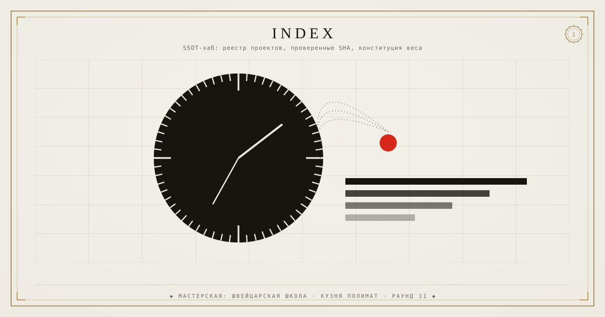

# index — SSOT-хаб аккаунта rtynbirf

<!--ФОРЖ:МУЗА:НАЧАЛО-->

  
   
  

<!--ФОРЖ:МУЗА:КОНЕЦ-->

Единый источник истины: живой реестр, метрики веса, канон правил.
Канон правил агентов: `.github/AGENTS.md` (наследуется всеми 63 репо).

## Живые цифры
- Репо: 63 (живых 20, архив 43)
- Вес аккаунта: 1711 МБ
- Цель клининга: ~615 МБ (−64%), главный резерв — история singulyar (1075 МБ)

## Живой реестр
Автоматически пересчитывается каждый час: **STATUS.md** и **metrics.json** в этом репо
(GitHub Actions: `metrics.yml`, история запусков — вкладка Actions).

## Схема SSOT
`projects.json`: id → repository → ref (реальный SHA) → status → description.
Код не копируется между репо — на него ссылаются по ref.

<!--ФОРЖ:ПОДВАЛ-->
---

  ◆ картина и штандарт — ручная ковка <a href="https://github.com/rtynbirf">КУЗНИ ПОЛИМАТ</a> · ЧЕЛОВЕК=АККАУНТ=PID1 ◆

