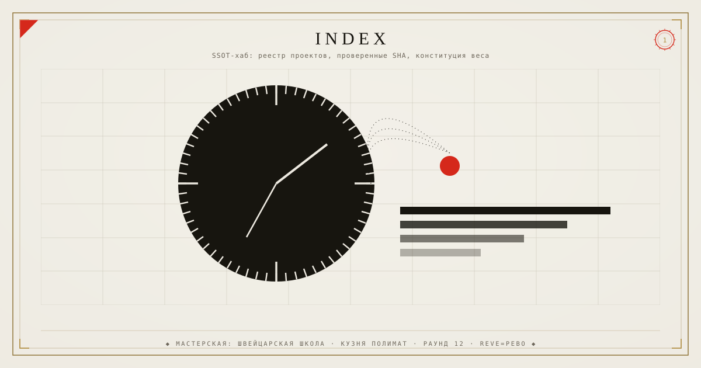
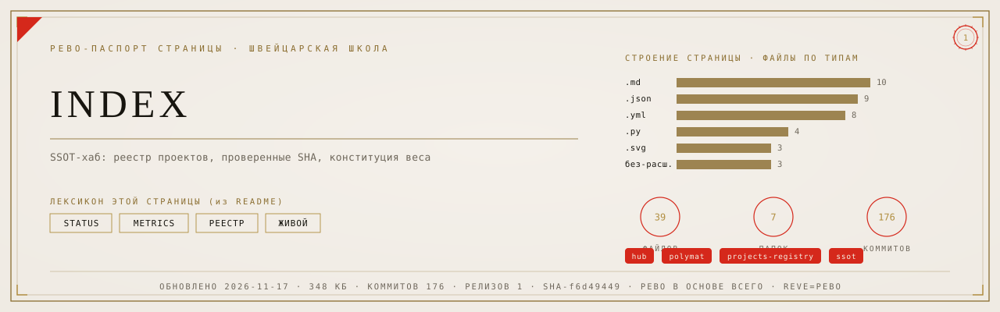

# index — SSOT-хаб аккаунта rtynbirf

<!--ФОРЖ:МУЗА:НАЧАЛО-->

  
   
  

<!--ФОРЖ:МУЗА:КОНЕЦ-->

<!--ФОРЖ:ПАСПОРТ:НАЧАЛО-->

  

| ФАЙЛОВ | ПАПОК | КОММИТОВ | ОБНОВЛЕНО | РЕЛИЗОВ |
|---:|---:|---:|---|---:|
| 39 | 7 | 181 | 2026-11-18 | 1 |
<!--ФОРЖ:ПАСПОРТ:КОНЕЦ-->

Единый источник истины: живой реестр, метрики веса, канон правил.
Канон правил агентов: `.github/AGENTS.md` (наследуется всеми 63 репо).

## Живые цифры — в STATUS.md

Статичные числа в README протухают, поэтому их здесь больше нет: реестр и метрики
пересчитываются каждый час воркфлоу `metrics.yml` и лежат в **STATUS.md** (человеку)
и **metrics.json** (машине). Это не декларация — это замер.

## Файлы-входы

- **STATUS.md** — живой реестр: все репо, вес, topics, описания, даты пуша (обновление каждый час).
- **metrics.json** — те же метрики машиночитаемо.
- **projects.json** — схема SSOT: id → repository → ref (реальный SHA) → status → description.
- **РЕЕСТР-НЕДОДЕЛАННОГО-МАСТЕР-ИНДЕКС.md** — что не доделано: честный список мастеров-индексов.

## Живой реестр
Автоматически пересчитывается каждый час: **STATUS.md** и **metrics.json** в этом репо
(GitHub Actions: `metrics.yml`, история запусков — вкладка Actions).

## Схема SSOT
`projects.json`: id → repository → ref (реальный SHA) → status → description.
Код не копируется между репо — на него ссылаются по ref.

<!--ФОРЖ:ПОДВАЛ-->
---

  ◆ картина и штандарт — ручная ковка <a href="https://github.com/rtynbirf">КУЗНИ ПОЛИМАТ</a> · ЧЕЛОВЕК=АККАУНТ=PID1 ◆

